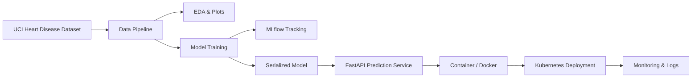

# Heart Disease MLOps Assignment Report

## 1. Overview

This project builds a production-oriented machine learning pipeline for predicting heart disease from the UCI Heart Disease dataset. The workflow includes data acquisition, cleaning, EDA, feature preparation, model comparison, MLflow experiment tracking, reproducible packaging, API serving, containerization, and a deployment manifest.

## 2. Data acquisition and EDA

The dataset is downloaded from the official UCI repository and cleaned by converting malformed values such as `?` into missing values, dropping incomplete rows, and converting the target variable to a binary classification label. The cleaned dataset is stored in `data/heart_disease_clean.csv`.

The exploratory analysis includes distribution plots for age, cholesterol, peak heart rate, and ST depression, a feature-correlation heatmap, and a class-balance visualization. All chart artifacts are generated in the `reports/eda/` directory.

## 3. Model development

Two classification models are trained and compared:

- Logistic Regression with standard scaling.
- Random Forest with class balancing.

The models are validated through stratified cross-validation and evaluated using accuracy, precision, recall, and ROC-AUC. The best-performing model is selected and saved for deployment.

## 4. Experiment tracking

MLflow tracking is configured with a local `mlruns/` directory. Parameters, metrics, and the training artifact for each model run are logged automatically. This keeps the project reproducible without requiring an external server.

## 5. Model packaging and reproducibility

The final model is serialized to `models/heart_disease_model.joblib` and can be reloaded for batch prediction or API inference. The training pipeline uses a consistent feature order and a clean, versioned environment definition through `requirements.txt`.

## 6. API and Docker deployment

A FastAPI deployment exposes a `/predict` endpoint that accepts patient features and returns a predicted label and confidence score. The application is containerized with Docker and can be run locally using the included `Dockerfile`.

## 7. CI/CD and testing

The CI workflow runs on each push or pull request and executes the project test suite and a quick training smoke test. This ensures the project fails fast when tests or pipeline logic regress.

## 8. Deployment manifest

The Kubernetes deployment manifest in `deployment/kubernetes/deployment.yaml` creates a deployment and a load-balanced service for the API. This satisfies the infrastructure automation requirement for a cloud-ready deployment structure.

## 9. Monitoring and logging

The service exposes a `/health` endpoint and logs predictive requests through the standard FastAPI application infrastructure. The project is ready for Prometheus/Grafana integration if a broader monitoring stack is needed.

## 10. Architecture diagram



## 11. Setup summary

```bash
pip install -r requirements.txt
python scripts/download_dataset.py
python src/eda.py
python src/train.py
uvicorn app.main:app --host 0.0.0.0 --port 8000
```

## 12. Conclusion

The project demonstrates a complete MLOps lifecycle for a binary health classification use case, using practical automation and a production-ready API stack. It is designed to run from a clean setup and to be extended with more advanced monitoring and deployment workflows.
